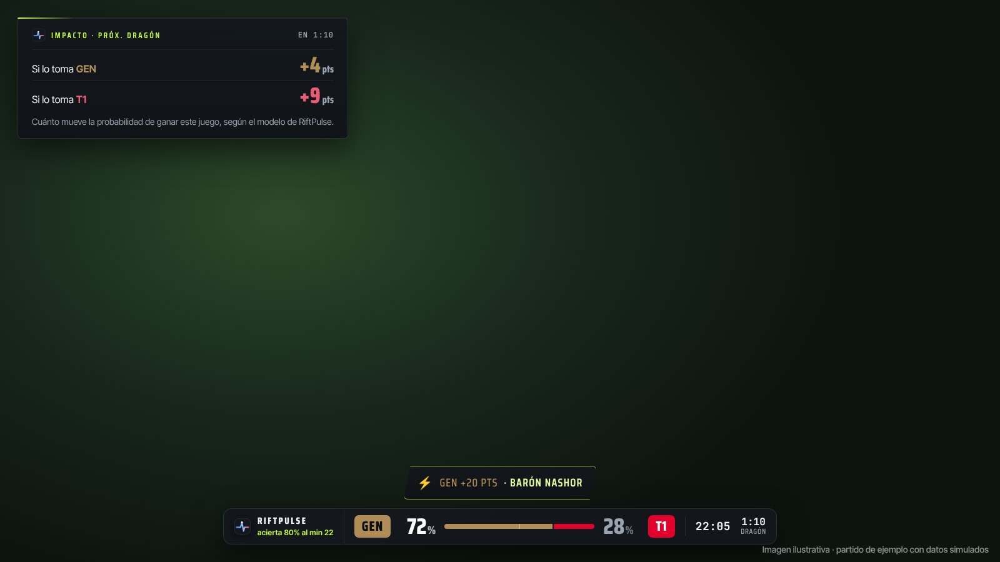
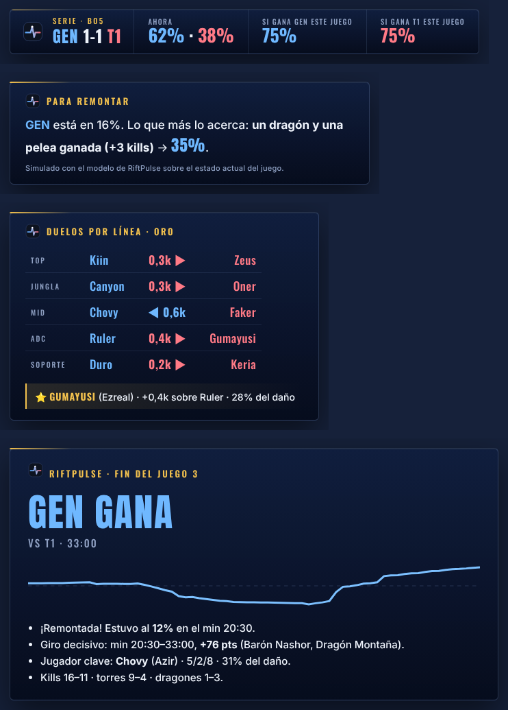

# Nick, esto lo hice pensando en streams como el tuyo

¡Hola, Nick! Soy **VectisDev**.

Te escribo porque tu stream es de los que más viven el LoL en español, y armé algo que creo que le puede sumar a tus partidas del Mundial: **RiftPulse**, un overlay que le muestra a tu chat **quién va ganando la partida, en vivo y en porcentaje**.

No es un número inventado: es un modelo entrenado con más de 2.200 juegos profesionales que **acierta el 75 % de las veces al minuto 15**, medido sobre 589 partidas que nunca había visto. Y lo muestra a la vista, sin esconder cuándo se equivoca.

## Lo que le puede sumar a tu stream

- 🔥 **Discusión con el chat.** «RiftPulse le da 81 % a T1… ¿se la dan vuelta?». El número arma la conversación sola.
- ⚡ **Alerta cuando la partida da vuelta.** Si tras un Barón la probabilidad salta 20 puntos, aparece un aviso en pantalla, justo en el momento que todos quieren comentar.
- 🎙 **Datos para comentar sin buscarlos.** Una segunda pantalla con frases listas: quién gana cada línea, qué necesita el que va perdiendo para remontar y cuánto vale este juego para la serie.
- 🏁 **Resumen al terminar cada juego.** Quién ganó, el momento que lo decidió y el jugador clave, con una imagen lista para tus redes.

## Probarlo te lleva un minuto

1. Entrá a **https://userf8a2c4.github.io/riftpulse-overlay** y tocá **📋 Copiar URL del overlay**.
2. En OBS: **＋ en Fuentes → Navegador** → pegá la URL → **1920 × 1080** → Aceptar.
3. Listo. Fondo transparente, detecta solo el partido del Mundial y no hay nada que configurar.

## Lo que te pido (y lo que no)

**Nada obligatorio.** Es gratis y no te pido nada a cambio.

Si lo probás un rato en una partida y me contás qué te gustó y qué no, ya me ayudás muchísimo. Y si te convence y te dan ganas de mostrarlo en el stream, para mí sería enorme.

Si querés, **lo adapto a vos**: los colores de tu canal o del SoloBoom, tu logo, o la pieza que se te ocurra que le falta.

## Para que estés tranquilo

- **No es de apuestas.** Es pronóstico y análisis; no hay casas de apuestas ni nada parecido.
- **No está afiliado a Riot Games.** Usa los datos públicos de LoL Esports y lleva el aviso correspondiente.
- **Es abierto.** Todo está en este repositorio y explicado en la [wiki](https://github.com/userf8a2c4/riftpulse-overlay/wiki), incluido cómo se mide la precisión.

¡Gracias por leer hasta acá! Ojalá lo veamos en una de tus partidas.

Un abrazo,
**VectisDev**
