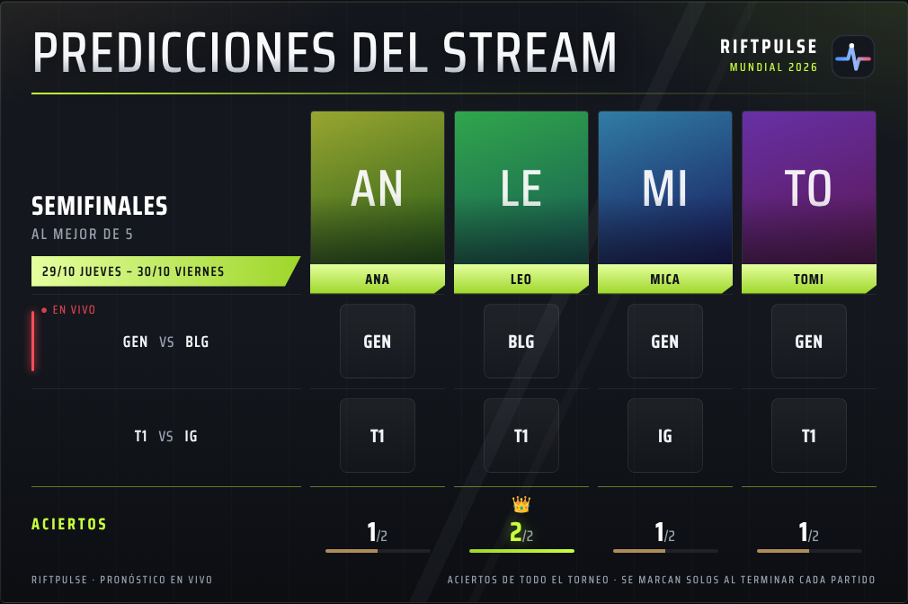
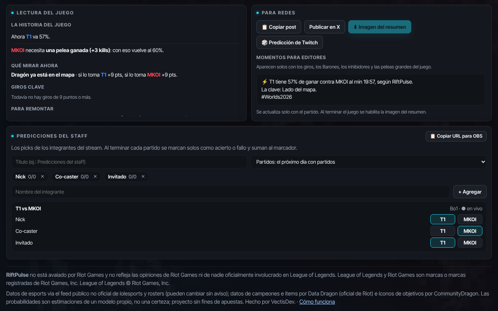
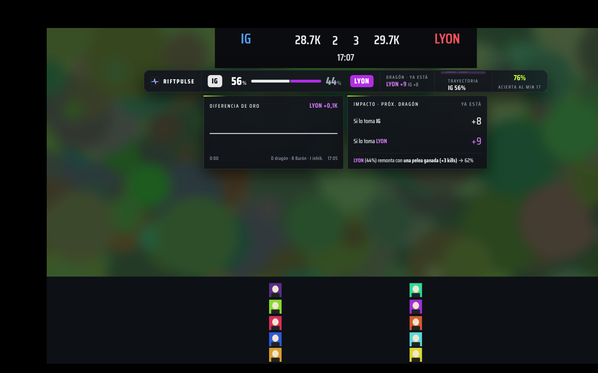
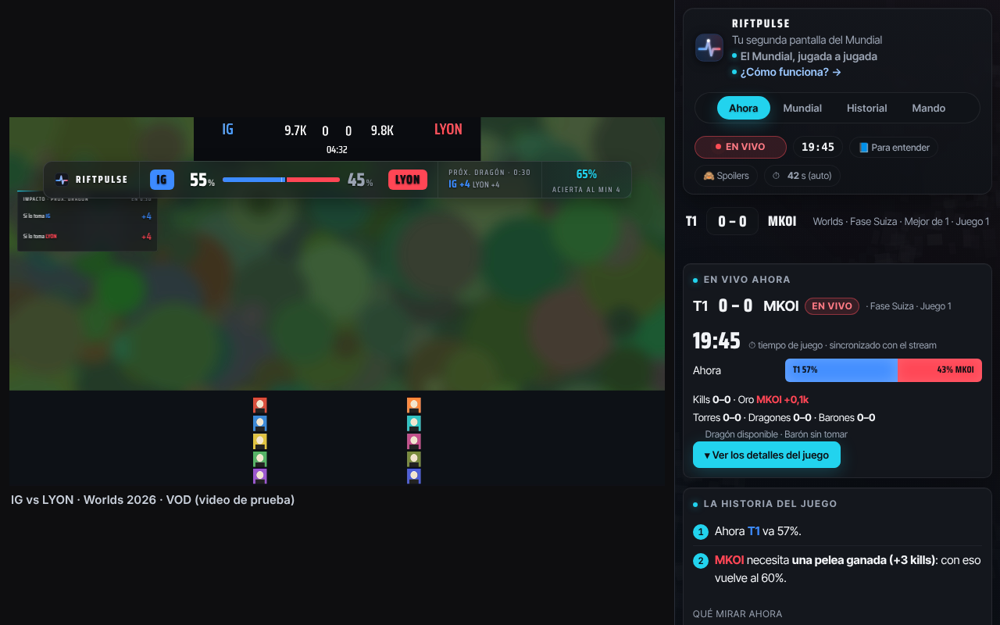
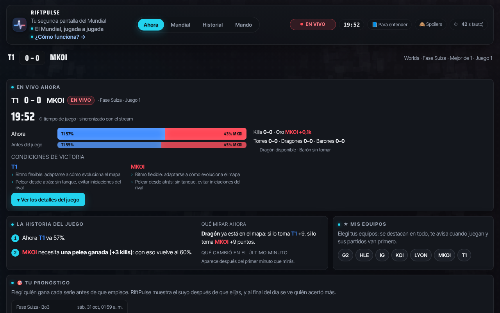

# Nick, esto lo hice pensando en streams como el tuyo

> 👉 **[Mirala acá, con la demo funcionando](https://userf8a2c4.github.io/riftpulse-overlay/nick.html)**

¡Hola, Nick! Soy **VectisDev**.

Te escribo porque tu stream es de los que más viven el LoL en español, y armé algo que creo que le puede sumar a tus partidas del Mundial: **RiftPulse**, un sistema para vivir el Mundial en tu stream. Un overlay que le muestra a tu chat **quién va ganando la partida, en vivo y en porcentaje**, un panel con todo lo que necesitás para comentar y una extensión para que tu comunidad lo tenga en su propia pantalla. Ponés **una sola URL en OBS y RiftPulse decide qué mostrar** en cada momento.

No es un número inventado: es un modelo entrenado con más de 2.200 juegos profesionales que **acierta el 75 % de las veces al minuto 15**, medido sobre 589 partidas que nunca había visto. Y lo muestra a la vista, sin esconder cuándo se equivoca.

## En tu stream (OBS)

- 🤖 **Se maneja solo.** El impacto antes del dragón o el Barón, lo que pasó en cada pelea en equipo, la alerta en un giro, qué necesita el que va abajo y el resumen al terminar entran y salen solos, nunca dos encima de la partida. Si querés, lo manejás con el teclado desde un panel dentro de OBS.
- 🎨 **Como el HUD de la transmisión.** El equipo de la izquierda en azul y el de la derecha en rojo, igual que el marcador de Riot. O todo en los colores de tu canal, con tu logo.
- 🔥 **Discusión con el chat.** «RiftPulse le da 81 % a T1… ¿se la dan vuelta?». El número arma la conversación sola.
- ⚡ **Alerta cuando la partida da vuelta.** Si tras un Barón la probabilidad salta 20 puntos, aparece un aviso en pantalla, justo en el momento que todos quieren comentar.
- ⚔️ **Cada pelea en equipo, explicada.** Después de un 5v5: quién la ganó, el oro, el objetivo que siguió y qué hizo cada jugador en la pelea. Las peleas chicas no interrumpen.
- 🏁 **Resumen al terminar cada juego.** Quién ganó, el momento que lo decidió y el jugador clave, con una imagen lista para tus redes.

## Para vos mientras comentás

- 🎙 **Guion listo para leer.** En el panel (Mando), frases para decir al aire: quién va ganando y por qué, la figura de la última pelea, qué necesita el que va abajo y el momento justo para un clip.
- 🗳 **Predicciones del staff.** Cargás los picks tuyos y de tus co-casters, los aciertos se marcan solos al terminar cada partido y la tabla sale en pantalla con una URL.
- 📊 **Mesa de análisis** para una segunda pantalla.

## Para tu chat

- 🖥 **La extensión, sobre el video.** Cada uno ve la probabilidad encima del partido en Twitch o lolesports, sincronizada sola con el minuto que está viendo: en vivo, en un VOD o en tu co-stream con su retraso. Aparece solo cuando el juego está en pantalla.
- 📱 **La app, con todo el Mundial.** El partido en vivo, la fase suiza, las eliminatorias, el pronóstico de cada uno contra RiftPulse y un modo sin spoilers.

 

**Si tu chat lo usa, todos miran el mismo número que vos.** 👉 **[Instalar la extensión](https://userf8a2c4.github.io/riftpulse-overlay/instalar.html#extension)** (3 pasos, 1 minuto) o **[abrir la app](https://userf8a2c4.github.io/riftpulse-overlay/app.html)** sin instalar nada.

## Probarlo te lleva un minuto

1. Entrá a **https://userf8a2c4.github.io/riftpulse-overlay** y tocá **📋 Copiar URL del overlay** (es la del director: `overlay.html?view=auto`).
2. En OBS: **＋ en Fuentes → Navegador** → pegá la URL → **1920 × 1080** → Aceptar.
3. Listo. Fondo transparente, detecta solo el partido del Mundial y no hay nada que configurar.

## Lo que te pido (y lo que no)

**Nada obligatorio.** Es gratis y no te pido nada a cambio.

Si lo probás un rato en una partida y me contás qué te gustó y qué no, ya me ayudás muchísimo. Y si te convence y te dan ganas de mostrarlo en el stream, para mí sería enorme.

Ya podés ponerle **los colores de tu canal y tu logo** con solo agregarlos a la URL (`&tema=canal&accent=` y `&logo=`). Las predicciones del staff también están listas para usar. Y si se te ocurre una pieza que le falta, la hago.

## Para que estés tranquilo

- **No es de apuestas.** Es pronóstico y análisis; no hay casas de apuestas ni nada parecido.
- **No está afiliado a Riot Games.** Usa los datos públicos de LoL Esports y lleva el aviso correspondiente.
- **Es abierto.** Todo está en este repositorio y explicado en la [wiki](https://github.com/userf8a2c4/riftpulse-overlay/wiki), incluido cómo se mide la precisión.

¡Gracias por leer hasta acá! Ojalá lo veamos en una de tus partidas.

📩 **Escribime por X: [@CaZe_18](https://x.com/CaZe_18)** y te respondo al toque.

Un abrazo,
**VectisDev**
