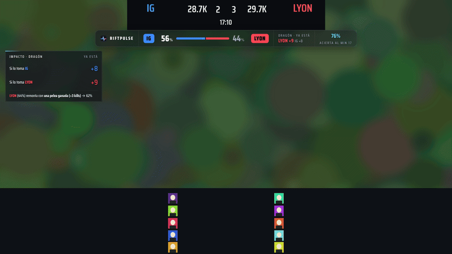
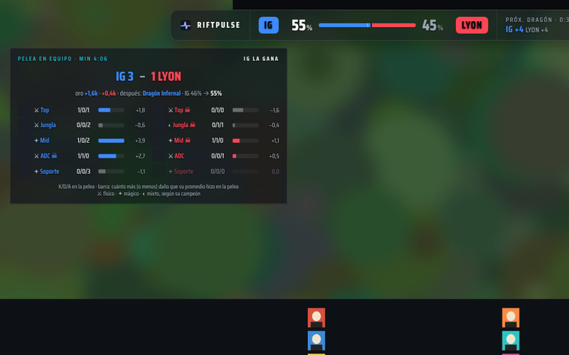
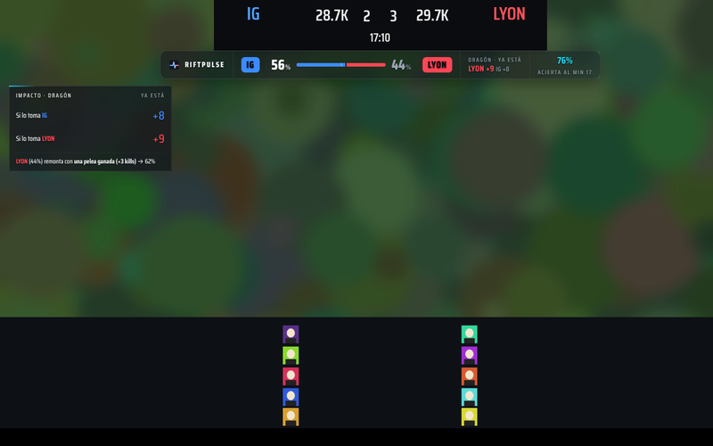
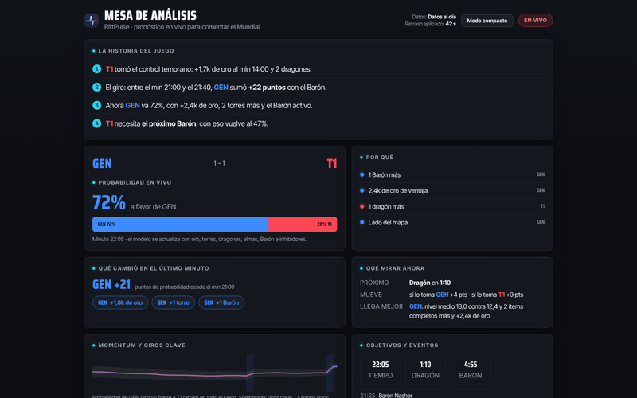
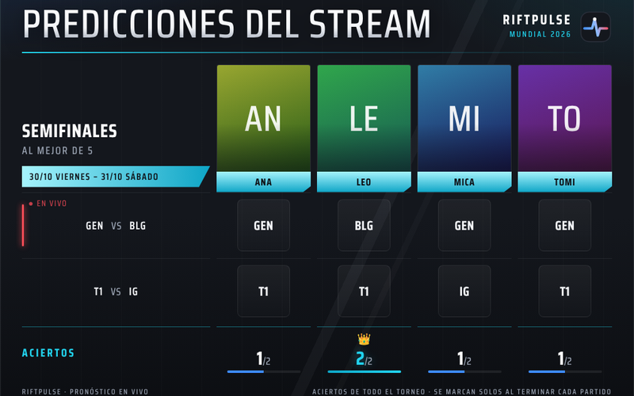
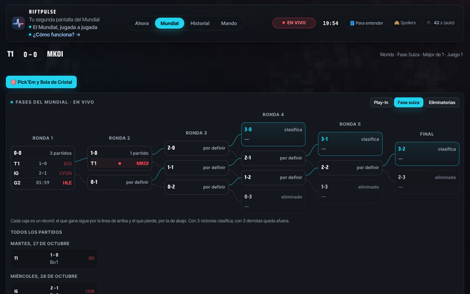
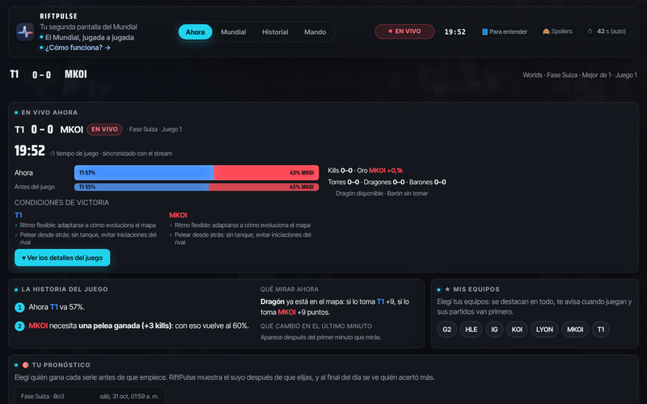

<div align="center">


<h1>RIFTPULSE</h1>

<h3>Tu segunda pantalla del Mundial · <i>El Mundial, jugada a jugada</i></h3>

<p>Quién va ganando cada partida del Mundial de League of Legends, <b>en vivo y en porcentaje</b>,<br>sobre el video que estás viendo, en tu stream de OBS o en el celular.</p>

<a href="https://userf8a2c4.github.io/riftpulse-overlay/instalar.html#extension"></a>
<a href="https://userf8a2c4.github.io/riftpulse-overlay/app.html"></a>
<a href="https://userf8a2c4.github.io/riftpulse-overlay/"></a>
<a href="https://userf8a2c4.github.io/riftpulse-overlay/como-funciona.html"></a>

<br>

[](https://userf8a2c4.github.io/riftpulse-overlay/como-funciona.html)
[](https://chromewebstore.google.com/detail/bkdmpcokjfgpnmkfnccgkakdincidoba)
[](#-instalar)
[](https://github.com/userf8a2c4/riftpulse-overlay/wiki/Cumplimiento-y-datos)
[](LICENSE)

</div>


<div align="center">



<sub>La extensión en acción: la probabilidad se mueve con la partida, llega una <b>pelea en equipo</b> y el juego da vuelta.<br>Video de prueba generado y números de ejemplo; las piezas son las reales.</sub>

</div>

> [!NOTE]
> **La extensión está en la [Chrome Web Store](https://chromewebstore.google.com/detail/bkdmpcokjfgpnmkfnccgkakdincidoba):** se instala con un clic y se actualiza sola. También se puede instalar a mano ([ver Instalar](#-instalar)); es la misma extensión.

<div align="center">

| <h2>75 %</h2>de acierto al minuto 15 | <h2>4.805</h2>juegos profesionales reales analizados | <h2>1 URL</h2>en OBS, y decide sola qué mostrar | <h2>0</h2>apuestas: pronóstico y análisis |
|:---:|:---:|:---:|:---:|

</div>


<div align="center">

🌐 **[Página](https://userf8a2c4.github.io/riftpulse-overlay/)** &nbsp;·&nbsp; 📚 **[Wiki](https://github.com/userf8a2c4/riftpulse-overlay/wiki)**

</div>

## 🎮 Tres formas de vivir el Mundial

<table>
<tr>
<td width="33%" valign="top" align="center">

<h3>🖥 Extensión</h3>
La probabilidad <b>encima del video</b> en Twitch o lolesports, <b>sincronizada sola con el minuto que ves</b> (en vivo, en un VOD o en un co-stream con retraso), y un panel lateral con todo el Mundial.<br><br>
<a href="https://userf8a2c4.github.io/riftpulse-overlay/instalar.html#extension"><b>Instalar en 4 pasos →</b></a>
</td>
<td width="33%" valign="top" align="center">

<h3>📱 App</h3>
En el celu o en la compu, <b>sin instalar nada</b>: el partido en vivo, la fase suiza, las eliminatorias, <b>tu pronóstico contra RiftPulse</b> y el modo sin spoilers.<br><br>
<a href="https://userf8a2c4.github.io/riftpulse-overlay/app.html"><b>Abrir la app →</b></a>
</td>
<td width="33%" valign="top" align="center">

<h3>🎥 OBS</h3>
El overlay para tu stream o co-stream: <b>una sola URL</b> y el director automático decide qué mostrar en cada momento, nunca dos piezas a la vez.<br><br>
<a href="https://userf8a2c4.github.io/riftpulse-overlay/"><b>Armar la URL →</b></a>
</td>
</tr>
</table>

## ⚡ Lo que hace

<table>
<tr>
<td width="50%" valign="top">

<h3>⚔️ Pelea en equipo, explicada</h3>
Después de cada <b>5v5</b>: quién la ganó, el oro, el objetivo que siguió, cómo cambió la probabilidad y lo que hizo cada jugador en la pelea. Las peleas chicas no interrumpen.
</td>
<td width="50%" valign="top">

<h3>🎯 Como el HUD de la transmisión</h3>
Azul a la izquierda y rojo a la derecha, pegado bajo el marcador oficial. Aparece <b>solo con el juego en pantalla</b> y desaparece en repeticiones, desk, publicidad y al terminar.
</td>
</tr>
<tr>
<td width="50%" valign="top">

<h3>🎙 Mesa de análisis</h3>
Segunda pantalla para casters: la historia del juego, qué cambió en el último minuto, qué mirar ahora, giros clave y <b>frases listas para comentar</b>.
</td>
<td width="50%" valign="top">

<h3>🗳 Predicciones del staff</h3>
Los picks de cada integrante del stream, con <b>aciertos que se marcan solos</b> al terminar cada partido y una URL lista para OBS.
</td>
</tr>
<tr>
<td width="50%" valign="top">

<h3>🏆 Todo el Mundial</h3>
Fase suiza visual, eliminatorias en vivo, favoritos al título con 20.000 simulaciones del torneo, y Pick'Em y Bola de Cristal.
</td>
<td width="50%" valign="top">

<h3>📊 Honesto con sus números</h3>
Muestra <b>por qué</b> va ganando cada equipo, qué movería el próximo dragón o Barón, y cuánto acierta el modelo en cada minuto, medido en juegos que no vio.
</td>
</tr>
</table>


## 🚀 Instalar

<table>
<tr>
<td width="50%" valign="top">

### 🖥 Extensión (Chrome, Edge, Brave, Opera)

1. **[Descargá el ZIP](https://userf8a2c4.github.io/riftpulse-overlay/riftpulse-extension.zip)** y extraelo: queda la carpeta **riftpulse-extension**.
2. Abrí `chrome://extensions` y activá el **Modo de desarrollador**.
3. **Cargar descomprimida** → esa carpeta.
4. En **Detalles**, activá **Permitir scripts de usuario**: así se actualiza sola. ¡Listo!

<sub>La guía con imágenes está en la <a href="https://userf8a2c4.github.io/riftpulse-overlay/instalar.html">página Instalar</a>. O con un clic desde la <a href="https://chromewebstore.google.com/detail/bkdmpcokjfgpnmkfnccgkakdincidoba">Chrome Web Store</a>.</sub>

</td>
<td width="50%" valign="top">

### 🎥 OBS

1. En la **[página](https://userf8a2c4.github.io/riftpulse-overlay/#stream)**, elegí la pieza y tu retraso, y tocá **📋 Copiar URL**.
2. En OBS: **＋ Fuentes → Navegador** → pegá la URL.
3. Ponele **1920 × 1080**. Fondo transparente, detecta solo el partido (sin partido, avisa «RiftPulse listo» unos segundos).

Para co-streams, el **mínimo radical**: `overlay.html?modo=minimo` (la barra sola; solo aparecen las peleas 5v5 que importan).

El **chat contra el modelo**: sumá `&canal=tu_canal` y tu chat vota antes de cada Barón o dragón. Y para que todo tu chat lo vea sin instalar nada: la [Extensión de Twitch](docs/twitch-extension.md).

<sub>Todos los parámetros de la URL, en <a href="docs/obs-parametros.md">docs/obs-parametros.md</a>. Piezas sueltas, colores de tu canal y escena lista en el <a href="https://github.com/userf8a2c4/riftpulse-overlay/wiki/Paquete-de-gráficos">paquete de gráficos</a>.</sub>

</td>
</tr>
</table>

## 🧠 Cómo calcula

Una regresión logística por minuto, entrenada con juegos profesionales 2025–26. Usa el oro, las kills, las torres, los dragones (y el alma), el Barón, los inhibidores, el draft y la fuerza de cada equipo.

| Momento | Antes del juego | Min 10 | Min 15 | Min 20 | Min 25 |
|---|:---:|:---:|:---:|:---:|:---:|
| **Acierto** | 62 % | 68 % | **75 %** | 79 % | 84 % |

<sub>Medido en 589 juegos que el modelo no vio. En octubre de 2026 se reentrenó con 4.805 juegos y se confirmó en 691 juegos nuevos de 2026. Nivel, CS, wards e ítems no mejoraron la predicción, así que el modelo se quedó como está. Detalle en <a href="https://userf8a2c4.github.io/riftpulse-overlay/como-funciona.html">Cómo funciona</a>, con simulador incluido.</sub>


<details>
<summary><b>📁 Estructura del repositorio</b></summary>
<br>

| Carpeta o archivo | Qué es |
|---|---|
| `index.html` | Página para streamers: la URL para OBS, la escena y el paquete de gráficos |
| `instalar.html` | Instalar: la extensión en 3 pasos, la app o OBS |
| `como-funciona.html` | Cómo calcula, con simulador y precisión |
| `app.html`, `app.css`, `app.js` | La app para fans (también es el panel lateral de la extensión). `app.html` se genera desde `fuente/app.html` |
| `overlay.html` + `obs.js` | El overlay de OBS y todas sus piezas (`?view=`) |
| `analista.html`, `control.html` | La mesa de análisis y el control de producción |
| `nick.html` | Presentación para casters |
| `engine.js` | El motor: datos en vivo, modelo, director, historia del juego y peleas en equipo |
| `ext-overlay.js` | El overlay de la extensión, ya armado (la versión manual lo baja de acá) |
| `fuente/` | El código del overlay de la extensión (`overlay.js`, `lector.js`: lee el reloj, el marcador y la serie del video), la plantilla de la app y `construir_extension.py`, que arma la extensión, `app.html`, `ext-overlay.js` y los dos ZIP |
| `riftpulse-extension.zip`, `riftpulse-extension-tienda.zip` | La extensión para instalar a mano y el paquete de la Chrome Web Store |
| `rp-tokens.css`, `rp-design.css`, `rp-ui.js` | El sistema visual común |
| `rp-i18n.js` | Idiomas: el selector ES \| EN y el diccionario español → inglés |
| `manifest.webmanifest`, `sw.js`, `icon-*.png` | La app instalable en el celular (PWA) |
| `riftpulse.obs-scene.json` | Escena lista para importar en OBS |
| `logo.svg` | La marca |
| `docs/img/` | Imágenes y GIF de este README y de la wiki |
| `docs/chrome-web-store/` | Ficha, capturas, ícono e imágenes promocionales de la tienda |
| `docs/carta-para-nick.md`, `docs/img/nick/` | Carta de presentación para casters y sus capturas |
| `docs/dossier.html` | El dossier del proyecto |
| `modelo/` | Recolección de juegos reales y reentrenamiento del modelo |
| `pruebas/` | Pruebas automáticas, simulador del feed y generadores de imágenes ([detalle](pruebas/README.md)) |
| `wiki/` | La fuente de la [wiki](https://github.com/userf8a2c4/riftpulse-overlay/wiki), que se publica sola |
| `.github/workflows/` | Pruebas y linter en cada cambio, publicar la wiki, sondear el feed real, probar con video real y reentrenar el modelo |
| `.eslintrc.json` | Las reglas del linter (cero errores y cero avisos) |

</details>

<details>
<summary><b>🛠 Para desarrollar</b></summary>
<br>

Hace falta Node, Playwright con Chromium, y Python 3 con Pillow y ffmpeg. Las mismas pruebas y el linter corren solos en GitHub con cada cambio ([Pruebas](.github/workflows/pruebas.yml)). El detalle de cada prueba está en [`pruebas/README.md`](pruebas/README.md).

Después de cambiar algo en `fuente/`, `app.js`, `app.css`, `engine.js`, `rp-ui.js` o `rp-i18n.js`, se arma todo lo que se publica (la extensión, `app.html`, `ext-overlay.js` y los ZIP):

```bash
python3 fuente/construir_extension.py
```

Las 14 baterías de pruebas, con un simulador del feed y videos generados:

```bash
node pruebas/todas.js
```

Las imágenes de la documentación y la wiki:

```bash
node pruebas/imagenes.js
```

La ficha de la Chrome Web Store (capturas y promocionales, en español y en inglés):

```bash
node pruebas/ficha-tienda.js
```

Las capturas de la página y la carta para Nick:

```bash
node pruebas/captura-extension.js
```

El GIF de este README:

```bash
node pruebas/gif.js
```

</details>

<details>
<summary><b>⚖️ Aviso legal</b></summary>
<br>

**Es pronóstico y análisis, no una casa de apuestas.** Las probabilidades son estimaciones de un modelo propio, no una certeza.

RiftPulse no está avalado por Riot Games y no refleja las opiniones de Riot Games ni de nadie oficialmente involucrado en la producción o gestión de League of Legends. League of Legends y Riot Games son marcas de Riot Games, Inc.

Usa los datos públicos de LoL Esports. Los datos de campeones e ítems salen de Data Dragon (Riot Games). Más en [Cumplimiento y datos](https://github.com/userf8a2c4/riftpulse-overlay/wiki/Cumplimiento-y-datos).

El código se publica bajo la licencia [AGPL-3.0](LICENSE).

</details>

<div align="center">

<br>


**Hecho por VectisDev** · [@CaZe_18](https://x.com/CaZe_18) · [Preguntas frecuentes](https://github.com/userf8a2c4/riftpulse-overlay/wiki/Preguntas-frecuentes) · [Licencia AGPL-3.0](LICENSE)

<sub>Las imágenes usan partidos de ejemplo con datos simulados y videos de prueba generados, no transmisiones reales.</sub>

</div>
