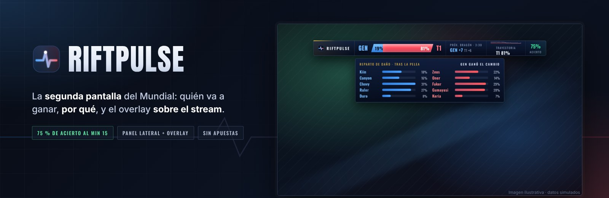
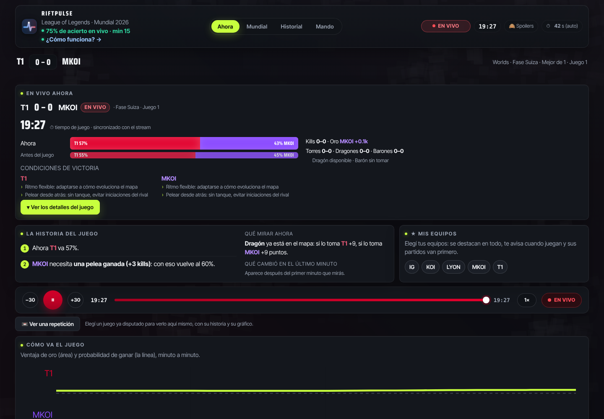
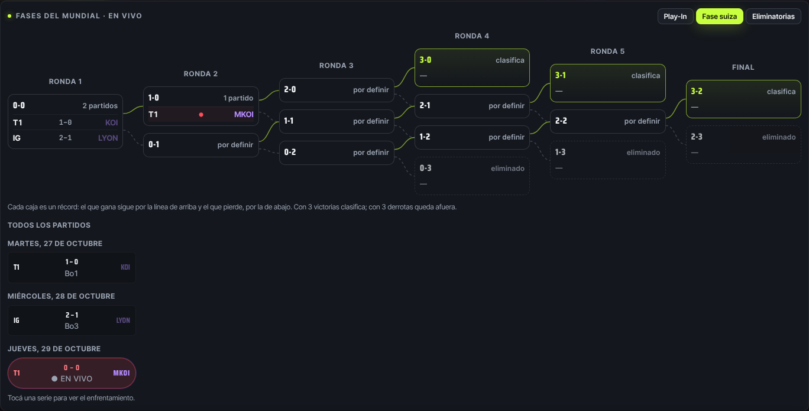
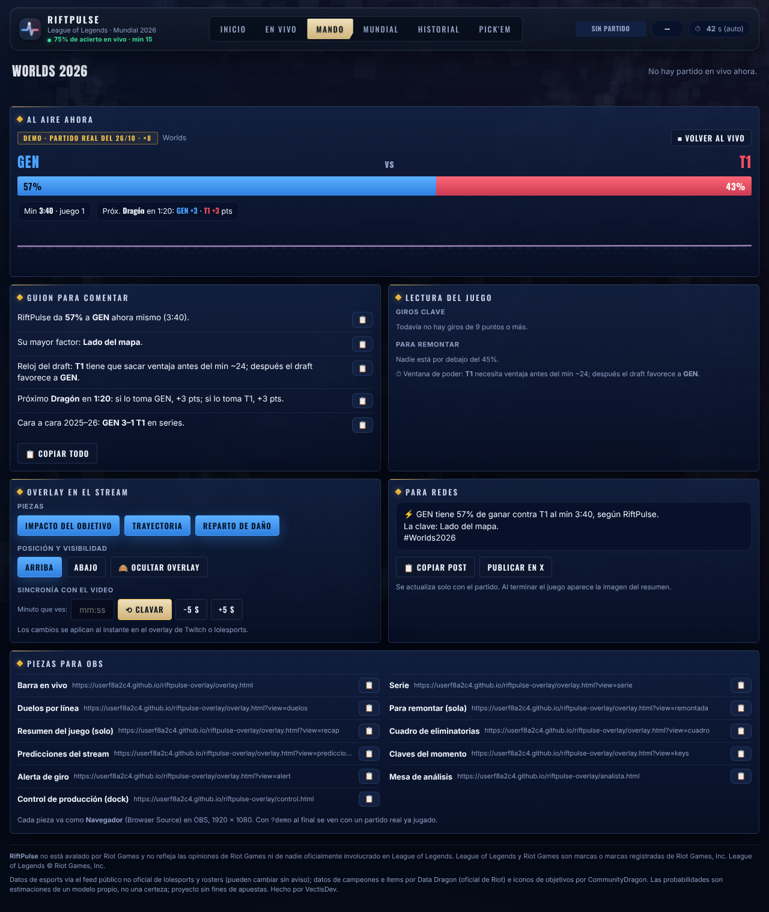
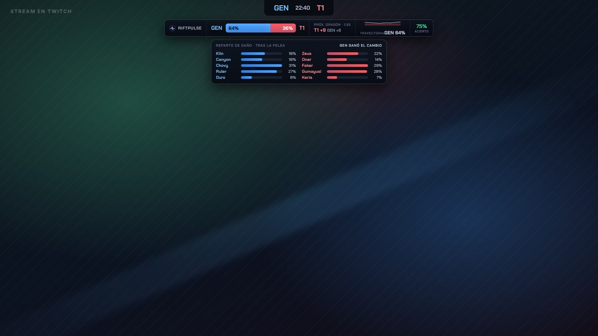
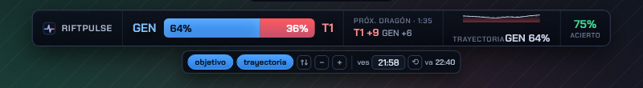

# RiftPulse

**Tu segunda pantalla del Mundial.** Para ver el **Mundial de League of Legends 2026 (Worlds)**: predicción en vivo del ganador con un modelo entrenado y **honesto sobre sus aciertos**, la historia de cada juego, simulación del torneo y ayuda para el Pick'Em oficial. Con el azul y el rojo de cada lado, como el HUD de la transmisión. **El Mundial, jugada a jugada.**

Es un solo archivo HTML, sin instalación ni servidor. Proyecto de código abierto, **sin funciones de apuestas**.

---

 Pestaña <b>Ahora</b>: el partido en vivo, la historia del juego, qué mirar ahora y mis equipos (datos de ejemplo).

## Qué aporta

- **Ahora:** una sola vista con el partido en vivo (o el próximo), **la historia del juego** en pocas frases, **qué mirar ahora** (el próximo objetivo, cuánto mueve y quién llega mejor), **qué cambió en el último minuto**, el gráfico con su banda de confianza y todos los detalles plegables.
- **Mis equipos:** elegí tus equipos; se destacan en todo, sus partidos van primero y te avisa cuando juegan.
- **Sin spoilers:** en el encabezado, ocultá los resultados de hoy, desde ayer o de todo el Mundial; tocá un marcador para verlo. En un VOD con la extensión se prende solo.
- **¿Quién va a ganar?** Un modelo de probabilidad entrenado con ~2,200 juegos profesionales reales, que se actualiza minuto a minuto y **explica por qué** (oro, torres, dragones, barón, draft, fuerza de los equipos).
- **Fiabilidad transparente.** La pestaña muestra cuánto acierta el sistema, medido **sin trampa** (cada predicción se hizo sin conocer el resultado), e incluye los juegos en que **falló**. En torneos previos acierta ~75 % del ganador al minuto 15.
- **Reproductor** para retroceder y adelantar cualquier juego, como un reproductor de video.

 La fase suiza en la pestaña <b>Mundial</b>: una caja por récord y los caminos entre rondas (datos de ejemplo).

- **Fase suiza visual** (pestaña «Mundial»): una columna por ronda, cada récord en su caja con sus partidos y los caminos del que gana y del que pierde, hasta el 3-0 o el 0-3.
- **Cuadro de eliminatorias en vivo** (pestaña «Mundial»): cuartos, semis y final con el marcador de cada serie, la que se está jugando y la probabilidad de cada equipo de ganarla o de llegar a cada llave.
- **Copa:** favoritos al título y el camino de cada equipo por fases, con 20,000 simulaciones del torneo.
- **Tarjetas para compartir:** el pronóstico de una serie, el resumen de un juego y **mi Pick'Em**, en imágenes de 1200 × 675 con el azul y el rojo de cada lado.
- **Pick'Em y Bola de Cristal:** sugerencias del sistema para el Pick'Em oficial (Sistema Suizo, eliminatorias) y para la Bola de Cristal (campeón más elegido, mejor % de victorias, mejor KDA), con enlace para registrarlos en lolesports.
- **Historial:** resumen de cada juego con el veredicto del sistema, comparación de equipos, jugadores, fotos y objetivos.
- **Centro de mando (pestaña «Mando»):** para streamers y analistas. Lo que está al aire (probabilidad, serie, próximo objetivo y trayectoria con los giros), un guion de frases para comentar con botón para copiarlas, la lectura del juego (giros clave, qué necesita el que va abajo, jugador clave), el control del overlay sobre el stream (piezas, posición, ocultar y sincronía al minuto que se ve), un post listo para X con la imagen del resumen al terminar, y las URL de cada pieza para OBS. Sin partido en vivo se puede probar con un partido real ya jugado.

 Pestaña <b>Mando</b> (datos de ejemplo).

- **Overlay sobre el stream:** con la extensión, una barra horizontal se acopla al HUD de la transmisión en Twitch: probabilidad, impacto del próximo objetivo, trayectoria y acierto. **Lee la sala:** avisa «Sincronizado» al reconocer el juego, se contrae cuando no hay juego en pantalla, toma los colores de la sigla del marcador y suma solo el panel que aporta. Al pasar el mouse muestra la **línea de tiempo** del juego: en un VOD, tocar un momento salta el video a ese instante.
- **Momentos para editores** (en Mando): los momentos clave del juego con el segundo exacto del VOD y los capítulos de YouTube listos para pegar.
- Iconos de objetivos (dragones por elemento, barón, torres, inhibidores), fotos de jugadores y nombres de campeones e ítems.

## Cómo usarlo

1. **Doble clic en `index.html`** (se abre en el navegador; sus estilos y su código están en `app.css` y `app.js`). No necesita internet para la interfaz, pero sí para traer los datos del Mundial.
2. Para que el navegador le dé permisos propios (algunos lo piden), **doble clic en `abrir.bat`**: abre la página en `http://localhost:8765`.
3. **Panel lateral y overlay:** instalá la extensión de la carpeta `extension/` (los 4 pasos están en `extension/INSTALAR.html`) para tener la app fija a la derecha y el overlay sobre el video.
4. **Publicar:** `python3 construir_extension.py` arma la extensión y copia la app y el overlay al repo web (`../riftpulse-overlay`).

 El overlay de la extensión sobre un video de prueba generado (no es una transmisión real), con el gráfico de oro y el impacto del próximo dragón.

### Sincronía con el stream
**Automática:** el overlay de la extensión lee del video el reloj del juego, los equipos, el marcador (oro y kills) y las victorias de cada equipo en la serie, reconoce qué partido y qué juego se está viendo y se clava a ese minuto. Funciona igual en vivo o con una repetición a cualquier hora, y sigue sola la pausa, la velocidad y los saltos del video. Se prende o apaga con el botón **sincronía automática** de los controles del overlay. **Alt+R** oculta y muestra el overlay. La lectura (OCR) va empaquetada en la extensión y se hace en tu computadora.

La página ajusta sola el retraso frente a la transmisión. Si ves un desfase, usá los botones **±** del menú ⏱ en la cabecera.

Con la sincronía automática apagada, pasá el mouse sobre la barra: escribí en **«minuto»** el minuto del juego que muestra el stream y tocá **⟲** (o Enter). El overlay se clava a ese instante y **«va»** muestra el minuto en que va, para comparar. Los botones **−/+** lo mueven de 5 en 5 segundos.

 La línea de tiempo con la banda de confianza y los controles de sincronía (video de prueba generado).

## Fuentes de datos

- **Data Dragon** (oficial de Riot Games): nombres e imágenes de campeones e ítems. No requiere clave.
- **Iconos de objetivos** (dragones, barón, heraldo, larvas, torres, inhibidores): imágenes del juego servidas por **CommunityDragon** (espejo comunitario de los assets de Riot), referenciadas en tiempo de ejecución.
- **Feed de lolesports** (`esports-api.lolesports.com`, `feed.lolesports.com`) y **rosters**: datos en vivo del Mundial. ⚠️ **No es una API pública oficial**: Riot no la documenta para terceros y puede cambiar o dejar de responder sin aviso. Cada quien corre la app por su cuenta.
- El modelo se entrenó con resultados públicos de partidos profesionales de 2025–2026.

## Modelo y honestidad

Las probabilidades son **estimaciones**, no certezas. El valor del proyecto está en la transparencia: el modelo se mide contra partidos que no vio y muestra tanto sus aciertos como sus fallos. No garantiza resultados y **no es una recomendación de apuesta**.

## Aviso legal

**RiftPulse** no está avalado por Riot Games y no refleja las opiniones de Riot Games ni de nadie oficialmente involucrado en la producción o gestión de League of Legends. League of Legends y Riot Games son marcas o marcas registradas de Riot Games, Inc. League of Legends © Riot Games, Inc.

## Licencia

Código bajo licencia **GNU AGPL-3.0** (ver `LICENSE`). La licencia cubre **el código de este proyecto**, no los datos, imágenes ni marcas de Riot Games, ni el feed no oficial de lolesports.
