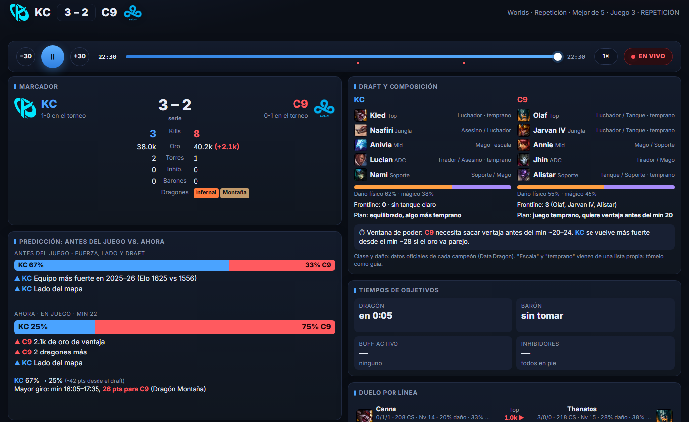

# RiftPulse

Una segunda pantalla para ver el **Mundial de League of Legends 2026 (Worlds)**: predicción en vivo del ganador con un modelo entrenado y **honesto sobre sus aciertos**, resumen de cada partido, simulación del torneo y ayuda para el Pick'Em oficial.

Es un solo archivo HTML, sin instalación ni servidor. Proyecto de código abierto, **sin funciones de apuestas**.

---

 Pestaña <b>Partido</b>: marcador, draft, predicción antes del juego frente a ahora, tiempos de objetivos y duelo por línea.

## Qué aporta

- **¿Quién va a ganar?** Un modelo de probabilidad entrenado con ~2,200 juegos profesionales reales, que se actualiza minuto a minuto y **explica por qué** (oro, torres, dragones, barón, draft, fuerza de los equipos).
- **Fiabilidad transparente.** La pestaña muestra cuánto acierta el sistema, medido **sin trampa** (cada predicción se hizo sin conocer el resultado), e incluye los juegos en que **falló**. En torneos previos acierta ~75 % del ganador al minuto 15.
- **Reproductor** para retroceder y adelantar cualquier juego, como un reproductor de video.
- **Copa:** favoritos al título y el camino de cada equipo por fases, con 20,000 simulaciones del torneo.
- **Pick'Em y Bola de Cristal:** sugerencias del sistema para el Pick'Em oficial (Sistema Suizo, eliminatorias) y para la Bola de Cristal (campeón más elegido, mejor % de victorias, mejor KDA), con enlace para registrarlos en lolesports.
- **Historial:** resumen de cada juego con el veredicto del sistema, comparación de equipos, jugadores, fotos y objetivos.
- **Centro de mando (pestaña «Mando»):** para streamers y analistas. Lo que está al aire (probabilidad, serie, próximo objetivo y trayectoria con los giros), un guion de frases para comentar con botón para copiarlas, la lectura del juego (giros clave, qué necesita el que va abajo, jugador clave), el control del overlay sobre el stream (piezas, posición, ocultar y sincronía al minuto que se ve), un post listo para X con la imagen del resumen al terminar, y las URL de cada pieza para OBS. Sin partido en vivo se puede probar con un partido real ya jugado.
- **Overlay sobre el stream:** con la extensión, una barra horizontal se acopla al HUD de la transmisión en Twitch o lolesports: probabilidad, impacto del próximo objetivo, trayectoria y acierto. Tras cada pelea de equipo aparece sola el **reparto de daño por jugador** y se oculta a los pocos segundos.
- Iconos de objetivos (dragones por elemento, barón, torres, inhibidores), fotos de jugadores y nombres de campeones e ítems.

## Cómo usarlo

1. **Doble clic en `index.html`** (se abre en el navegador). No necesita internet para la interfaz, pero sí para traer los datos del Mundial.
2. Para que el navegador le dé permisos propios (algunos lo piden), **doble clic en `abrir.bat`**: abre la página en `http://localhost:8765`.
3. **Panel lateral:** instale la extensión de la carpeta `extension/` (ver `extension/INSTALAR.txt`) para tener la app fija a la derecha mientras ve el stream.

 El overlay de la extensión sobre el stream, con el reparto de daño tras una pelea (partido de ejemplo, datos simulados).

### Sincronía con el stream
La página ajusta sola el retraso frente a la transmisión. Si ve un desfase, use los botones **±** del menú ⏱ en la cabecera.

En el overlay, pase el ratón sobre la barra: escriba en **«ves»** el minuto del juego que muestra el stream y pulse **⟲** (o Enter). El overlay se clava a ese instante y **«va»** muestra el minuto en que va, para comparar. Los botones **−/+** lo mueven de 5 en 5 segundos.

## Fuentes de datos

- **Data Dragon** (oficial de Riot Games): nombres e imágenes de campeones e ítems. No requiere clave.
- **Iconos de objetivos** (dragones, barón, heraldo, larvas, torres, inhibidores): imágenes del juego servidas por **CommunityDragon** (espejo comunitario de los assets de Riot), referenciadas en tiempo de ejecución.
- **Feed de lolesports** (`esports-api.lolesports.com`, `feed.lolesports.com`) y **rosters**: datos en vivo del Mundial. ⚠️ **No es una API pública oficial**: Riot no la documenta para terceros y puede cambiar o dejar de responder sin aviso. Cada quien corre la app por su cuenta.
- El modelo se entrenó con resultados públicos de partidos profesionales de 2025–2026.

## Modelo y honestidad

Las probabilidades son **estimaciones**, no certezas. El valor del proyecto está en la transparencia: el modelo se mide contra partidos que no vio y muestra tanto sus aciertos como sus fallos. No garantiza resultados y **no es una recomendación de apuesta**.

## Aviso legal

**RiftPulse** no está avalado por Riot Games y no refleja las opiniones de Riot Games ni de nadie oficialmente involucrado en la producción o gestión de League of Legends. League of Legends y Riot Games son marcas o marcas registradas de Riot Games, Inc. League of Legends © Riot Games, Inc.

## Licencia

Código bajo licencia **GNU AGPL-3.0** (ver `LICENSE`). La licencia cubre **el código de este proyecto**, no los datos, imágenes ni marcas de Riot Games, ni el feed no oficial de lolesports.
