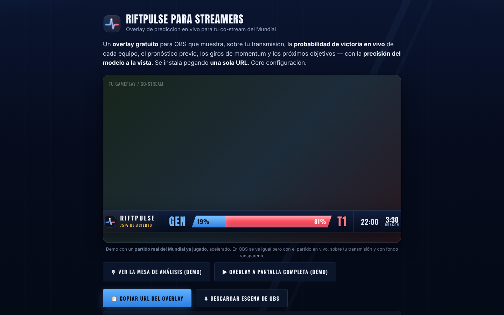
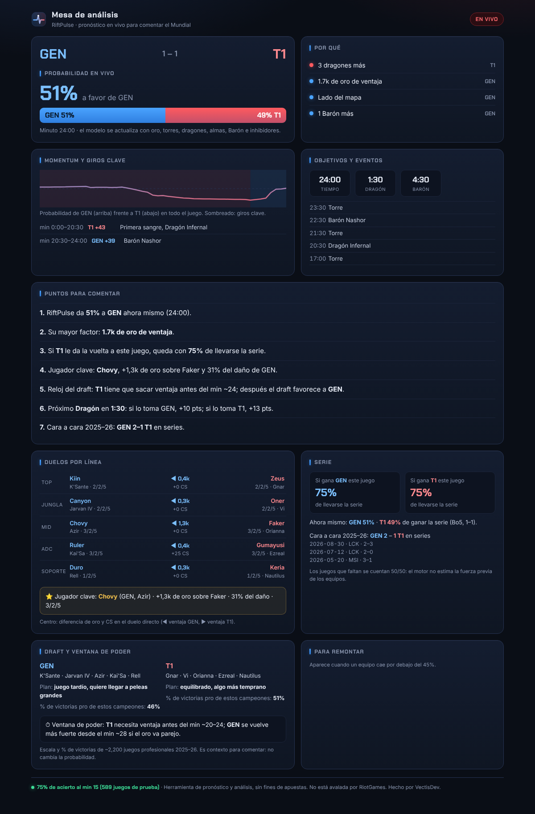
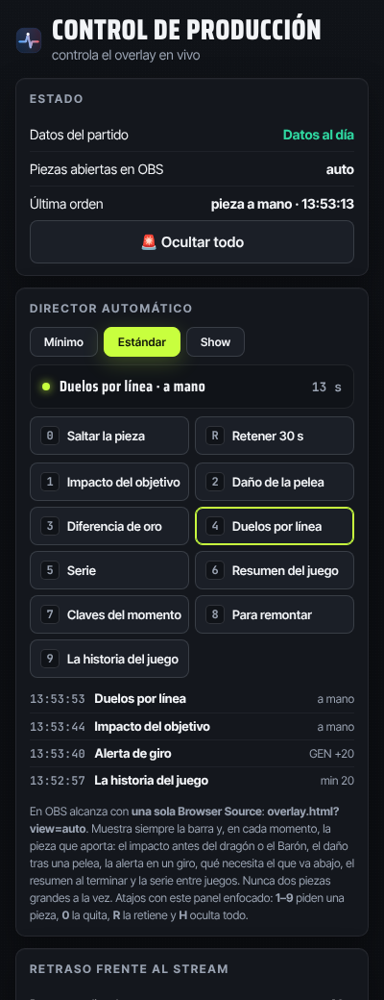

# RiftPulse

**Pronóstico de League of Legends Esports en vivo — como overlay para tu transmisión.**

**[Overlay](overlay.html)** · **[Mesa de análisis](analista.html)** · **[Control](control.html)** · **[Instrucciones](INSTRUCCIONES-NICK.md)** · **[Página](https://userf8a2c4.github.io/riftpulse-overlay/)**

> [!IMPORTANT]
> **Es pronóstico y análisis, no una casa de apuestas.** Las probabilidades son estimaciones de un modelo propio, no una certeza. RiftPulse no está avalado por Riot Games. League of Legends y Riot Games son marcas de Riot Games, Inc.

## ¿Qué es?

RiftPulse estima, **en tiempo real**, la probabilidad de victoria de cada equipo del Mundial y la pone sobre la transmisión. Se añade a OBS como **Browser Source** pegando **una sola URL**: fondo transparente, autodetecta el partido en vivo y muestra su propia **precisión** de forma abierta.

Un **motor**, varias caras: el overlay para la transmisión, una **mesa de análisis** para el equipo de comentaristas y un **panel de control** para producción — todo del mismo modelo.

## Así se ve

 La barra en vivo abajo, las <b>claves del momento</b> arriba a la izquierda y una <b>alerta</b> cuando la probabilidad da un giro fuerte. Fondo transparente en OBS.

## Lo que incluye

<table>
<tr>
<td width="50%" valign="top">

### 🎬 Overlay para OBS
Un lower-third limpio con la **probabilidad en vivo**, el marcador, los objetivos y la precisión del modelo. Varias piezas conmutables con `?view=`: barra, tarjeta grande, alerta, objetivos, claves, **serie**, **duelos por línea**, **para remontar** (aparece sola) y **resumen del juego** (aparece solo al terminar).

</td>
<td width="50%" valign="top">

### 🎛 Mesa de análisis
Segunda pantalla para casters: probabilidad, **el porqué**, momentum con los **giros clave**, **duelos por línea** y jugador clave, **la serie** (si gana o pierde este juego), **cara a cara**, **ventana de poder del draft**, **qué necesita el que va abajo para remontar** y **frases listas para comentar**. Al terminar cada juego, un **resumen descargable como imagen** para redes.

</td>
</tr>
<tr>
<td width="50%" valign="top">

### 🎚 Control de producción
Enciende/apaga módulos, cambia la posición y **dispara alertas en vivo**. Se añade en OBS como *Dock de navegador* y habla con el overlay sin recargar.

</td>
<td width="50%" valign="top">

### 📊 Precisión a la vista
Cada gráfico lleva el acierto real del modelo. Nada inflado: es el resultado de una prueba sobre **589 juegos que el modelo no vio**.

</td>
</tr>
</table>

### 🎙 Piezas para casters y streamers

 <code>?view=serie</code> · <code>?view=remontada</code> (aparece sola) · <code>?view=duelos</code> · <code>?view=recap</code> (aparece solo al terminar el juego)

Las capturas usan un partido de ejemplo con datos simulados; en vivo, los datos salen del feed de LoL Esports.

## Instalar en OBS

> [!NOTE]
> GitHub no ejecuta archivos HTML: para usarlo, publica el repo con **GitHub Pages** (abajo) y usa la URL que te da. Abrir `overlay.html` aquí solo muestra el código.

1. Abre la **[página](https://userf8a2c4.github.io/riftpulse-overlay/)** y toca **📋 Copiar URL del overlay**.
2. En OBS: **＋ en Fuentes → Navegador** → pega la URL → **1920 × 1080** → Aceptar.
3. ¡Listo! Aparece con fondo transparente. Arrástralo donde quieras.

**Aún más rápido:** en la página, **⬇ Descargar escena de OBS** → en OBS **Escena → Importar**.

## Precisión (verificada)

Prueba sobre **589 juegos que el modelo no vio** (ago–oct 2026). Una moneda acierta el 50 % (error Brier 0,250; menor es mejor).

| Momento | Acierto | Error Brier |
|---|---|---|
| Antes del juego | 62 % | 0,221 |
| Minuto 10 | 68 % | 0,202 |
| **Minuto 15** | **75 %** | **0,173** |
| Minuto 20 | 79 % | 0,145 |
| Minuto 25 | 84 % | 0,114 |

## Publicar con GitHub Pages

1. Sube este repositorio (público).
2. **Settings → Pages → Branch: `main` → /(root) → Save**.
3. En ~1 minuto tienes la URL: `https://userf8a2c4.github.io/riftpulse-overlay/` (la página) y `…/overlay.html` (el overlay para OBS). La página calcula las URLs correctas sola; no hay que editar nada.

<b>Ajustes del overlay (por URL)</b>

 

| Parámetro | Qué hace |
|---|---|
| `?view=` | `bar` (por defecto) · `big` · `alert` · `objectives` · `keys` · `serie` · `duelos` · `remontada` · `recap` |
| `?pos=` | `bottom` (por defecto) o `top` |
| `?scale=` | tamaño, p. ej. `1.2` |
| `?modules=` | qué mostrar: `prob,pregame,momentum,timers,brand` |

Sin parámetros, ya funciona.

<b>Cómo funciona el modelo</b>

 

- **Fuerza de los equipos:** un Elo con los partidos de 2025–26 de las ligas principales e internacionales.
- **Estado del juego:** una regresión logística por minuto sobre oro, kills, torres, dragones, almas, Barón, inhibidores y la curva del draft. Entrenada con **2 247 juegos** profesionales.
- La probabilidad se actualiza cada 2 segundos con el feed público de LoL Esports.

<b>Cumplimiento</b>

 

- **Sin apuestas:** es pronóstico y análisis; no integra funcionalidad de casa de apuestas.
- **Atribución:** datos de campeones por Data Dragon (oficial de Riot) e íconos por CommunityDragon; feed de esports público no oficial de lolesports.
- **No afiliado a Riot Games**, con el aviso correspondiente en todas las piezas.

<b>Estructura del repositorio</b>

 

| Archivo | Para qué |
|---|---|
| `overlay.html` + `obs.js` | El overlay de OBS (varias vistas con `?view=`) |
| `analista.html` | Mesa de análisis (segunda pantalla) |
| `control.html` | Panel de control de producción |
| `index.html` | Página "para streamers" (copiar URL, descargar escena, pack) |
| `engine.js` | Motor: datos + modelo (misma fuente que la app) |
| `logo.svg` | Marca |
| `docs/img/` | Imágenes de este README |
| `riftpulse.obs-scene.json` | Escena de OBS de respaldo (OBS 28+) |
| `INSTRUCCIONES-NICK.md` | Guía rápida de instalación (ES + EN) |

Más detalle en la **[Wiki](../../wiki)**.

## Autoría

**VectisDev** · herramienta de pronóstico y análisis para la comunidad de League of Legends Esports.
